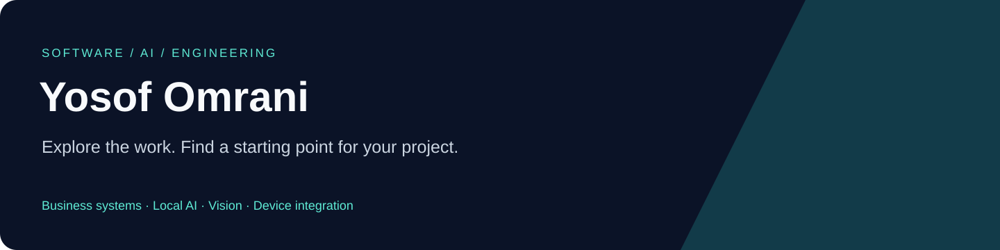

# Yosof Omrani · Software & Engineering Portfolio

**Business applications, local AI workflows, document automation and hardware integration — source examples for technical review and project collaboration.**

[فارسی](docs/README.fa.md) · [Browse the portfolio website](https://ali771025.github.io/software-portfolio/) · [Discuss a project](https://github.com/Ali771025/software-portfolio/issues/new?template=project-inquiry.yml)

## Start with your business need

| Need | Relevant source examples |
| --- | --- |
| Organize records, documents and contracts | [ArchiveSystem](https://github.com/Ali771025/ArchiveSystem), [Contracts Next](https://github.com/Ali771025/contracts-next) |
| Query business data in Persian or organize internal knowledge | [AI Query .NET](https://github.com/Ali771025/ai-query-dotnet), [Persian NL2SQL](https://github.com/Ali771025/persian-nl2sql), [RAG Knowledge Platform](https://github.com/Ali771025/rag-knowledge-platform) |
| Build recruitment, finance or operational workflows | [Recruitment](https://github.com/Ali771025/ai-recruitment-platform), [Portfolio Manager](https://github.com/Ali771025/smart-portfolio-manager) |
| Process scientific images, video or document text | [X-ray Mosaic](https://github.com/Ali771025/xray-mosaic-studio), [YOLO Toolkit](https://github.com/Ali771025/offline-yolo-toolkit), [OCR Extractor](https://github.com/Ali771025/ocr-text-extractor) |
| Connect desktop software to devices or industrial networks | [Qt Serial Joystick](https://github.com/Ali771025/qt-serial-joystick), [STM32 Bridge](https://github.com/Ali771025/stm32-ethernet-serial-bridge) |

## All source examples

The collection includes **28 project editions**: 27 newly prepared source snapshots plus the previously published ArchiveSystem. Related old releases and exported copies are consolidated, rather than presented as new products.

### Business applications

| Project | What to explore | Edition |
| --- | --- | --- |
| [ArchiveSystem](https://github.com/Ali771025/ArchiveSystem) | Case and document workflows, Persian RTL UI and processing workers. | Source edition |
| [AI Recruitment Platform](https://github.com/Ali771025/ai-recruitment-platform) | Next.js/Prisma recruitment and talent-workflow application source. | Source edition |
| [Smart Portfolio Manager](https://github.com/Ali771025/smart-portfolio-manager) | Flutter/FastAPI source for investment and accounting-oriented workflows. | Source edition |
| [Contracts Next](https://github.com/Ali771025/contracts-next) | Windows WPF source for contract lifecycle and reporting workflows. | Source edition |
| [Learning Management System](https://github.com/Ali771025/learning-management-system) | Course, exam and reporting source; corrupt original modules need recovery. | Incomplete source |
| [Access Contract Manager](https://github.com/Ali771025/access-contract-manager) | Legacy Access/VBA workflow source without the operational database. | Legacy modernization excerpt |
| [Correspondence Workflow](https://github.com/Ali771025/correspondence-workflow-php) | Partial legacy PHP workflow excerpt for modernization review. | Legacy modernization excerpt |
| [Engineering Document Register](https://github.com/Ali771025/engineering-document-register) | Legacy PHP project/document register source and export entry points. | Legacy modernization excerpt |

### AI, knowledge and reporting

| Project | What to explore | Edition |
| --- | --- | --- |
| [AI Query · .NET](https://github.com/Ali771025/ai-query-dotnet) | Layered reporting backend with a React query workspace. | Source edition |
| [Persian NL2SQL](https://github.com/Ali771025/persian-nl2sql) | Schema retrieval and policy-aware question-to-SQL source. | Source edition |
| [RAG Knowledge Platform](https://github.com/Ali771025/rag-knowledge-platform) | FastAPI/React source for document-grounded knowledge workflows. | Source edition |
| [Persian Voicebot](https://github.com/Ali771025/persian-voicebot) | FastAPI/n8n speech and local-model integration source. | Source edition |
| [RAG Document Standardizer](https://github.com/Ali771025/rag-document-standardizer) | SQL/Markdown parsing, evidence checks and human-review workflow. | Source edition |
| [Offline AI Workspace](https://github.com/Ali771025/offline-ai-workspace) | Local AI services and integration/deployment configuration examples. | Research / examples |

### Computer vision and document processing

| Project | What to explore | Edition |
| --- | --- | --- |
| [X-ray Mosaic Studio](https://github.com/Ali771025/xray-mosaic-studio) | Scientific image registration and desktop mosaic tooling source. | Source edition |
| [Stereo Vision Ranging](https://github.com/Ali771025/stereo-vision-ranging) | Camera calibration, stereo geometry and detection workflow source. | Research / examples |
| [Offline YOLO Toolkit](https://github.com/Ali771025/offline-yolo-toolkit) | Python/C++ detection, monitoring and dataset annotation source. | Source edition |
| [OCR Text Extractor](https://github.com/Ali771025/ocr-text-extractor) | Small .NET/Tesseract document-to-text console source. | Source edition |

### Desktop, embedded and simulator integration

| Project | What to explore | Edition |
| --- | --- | --- |
| [Qt Serial Joystick](https://github.com/Ali771025/qt-serial-joystick) | Qt/C++ interface and serial protocol integration source. | Source edition |
| [STM32 Ethernet–Serial Bridge](https://github.com/Ali771025/stm32-ethernet-serial-bridge) | Embedded C source for Ethernet/serial communication and board bring-up. | Source edition |
| [Prepar3D AI Pilot](https://github.com/Ali771025/prepar3d-ai-pilot) | Simulator integration and bounded control/planning research source. | Research / examples |
| [Bounded UAV Planner](https://github.com/Ali771025/bounded-uav-planner) | Research source for supervised intent, telemetry and operator dashboards. | Research / examples |

### Interface prototypes

| Project | What to explore | Edition |
| --- | --- | --- |
| [Superapp Interface](https://github.com/Ali771025/superapp-interface) | React/TypeScript interface exploration with preview adapters. | Interface prototype |
| [AI Service Marketplace UI](https://github.com/Ali771025/ai-service-marketplace-ui) | Consumer/creator/platform workspace prototype with local mock auth. | Interface prototype |
| [Learning Platform Interface](https://github.com/Ali771025/learning-platform-interface) | Learning dashboards, course views and placement-flow UI prototype. | Interface prototype |

### Research kits and small utilities

| Project | What to explore | Edition |
| --- | --- | --- |
| [LLM Agent Research Kit](https://github.com/Ali771025/llm-agent-research-kit) | Provider examples and dependency profiles, without bundled SDK binaries. | Research / examples |
| [Video Downloader Desktop](https://github.com/Ali771025/youtube-downloader-desktop) | Small Tkinter/yt-dlp desktop utility source. | Source edition |
| [Engineering Experiments](https://github.com/Ali771025/engineering-experiments) | Circuit netlist automation and tabular regression learning examples. | Research / examples |

## How to evaluate this portfolio

Each repository explains its actual source scope, architecture, setup prerequisites and limitations. SVG visuals are architecture illustrations; they are not invented product screenshots. ArchiveSystem includes actual UI captures with synthetic records.

No new tests or builds were run for this batch. Source publication does not establish production readiness, OCR accuracy, financial performance, live simulator authority or physical-board acceptance. Prototype, research, legacy and incomplete editions are labeled so they can be evaluated appropriately.

Contracts, private customer material, operational databases, credentials, old Git histories, dependency caches, model weights, installers and generated outputs are excluded. The repository-specific source notices still apply; publication does not invent a new blanket reuse license.

## Start a collaboration

[**Describe your project →**](https://github.com/Ali771025/software-portfolio/issues/new?template=project-inquiry.yml)

A short description of the problem, target users, current systems and constraints is enough to start. Mention the examples most relevant to your idea. Share only a non-confidential summary in a public issue; private project details need a private communication channel first.

[GitHub profile](https://github.com/Ali771025) · [Publication scope](docs/PUBLICATION.md)
